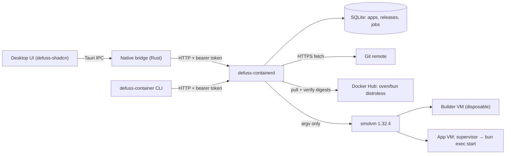

# Architecture

defuss-container runs each Bun application in its own persistent Linux microVM. A user-level daemon owns all state and is the only process that runs Git or the VM engine. The CLI and the desktop UI are thin HTTP clients of that daemon.

## Why this shape

- **One daemon, thin clients.** Jobs outlive the CLI and the GUI. A loopback HTTP API with a rotating bearer token works the same from the CLI, the Tauri bridge and the e2e suite. A library linked into each client would need its own locking and lifetime rules.
- **Engine CLI, not the smolmachines SDK.** The SDK documents Linux and macOS only. The engine CLI also covers Windows, and every flag the adapter passes was checked against the pinned 1.32.4 binary (see [docs/VERIFICATION.md](docs/VERIFICATION.md#macos-notes)).
- **Repository code never runs on the host.** Git only fetches and archives. Install and build scripts run in a disposable VM with private networks blocked.

## Build pipeline

1. Initialize a bare Git repository in a private temporary directory. HTTPS-fetch the requested ref without submodules, hooks or redirects, resolve an immutable commit and archive the selected tree.
2. Resolve `oven/bun:1.4.4-distroless` for the host architecture. Verify the platform manifest and every config and layer blob by SHA-256, and record the base digest in the release.
3. Create a disposable machine with private-network egress blocked, read-only source and helper shares, and one writable export directory. Inside it: frozen install with lifecycle scripts disabled, optional `scripts.build`, then a production-only reinstall.
4. Pack the app into a tar layer under `opt/defuss/releases/<id>/` and delete the builder. On the host, refuse a symlinked or hardlinked layer, delete every other builder output, check every entry's path, link target, type and size, then assemble an OCI layout plus a Docker-save `manifest.json` for smolvm's importer.
5. Persist the release only after the artifact is complete. A failed build never becomes deployable.

## Runtime

Each application owns one named machine. Its image holds the Bun base, the first release and a runtime layer with `supervisor.mjs`, `archive.mjs` and `policy.mjs`. A host-private `launch.json` and a read-only release share select the code release, so a deploy does not replace the VM or `/app/var`. Switching code stops and starts the machine; there is no zero-downtime claim.

On start the supervisor:

1. verifies the release layer checksum, extracts it into an empty staging tree and moves it into place,
2. links `var`, `tmp`, `input`, `output` and `etc` into the release, empties `tmp`, and adds `host` (the virtio-net gateway `100.96.0.1`) to `/etc/hosts`,
3. runs `scripts.start` with `bun exec`, in its own process group.

VERIFIED: the distroless image has no `/bin/sh`, and Bun 1.4.4 `bun run --shell=bun <script>` still fails there with `MissingShell`. `bun exec` runs the same script text in Bun Shell, with `node_modules/.bin` prepended to `PATH`. Pre/post lifecycle scripts are therefore not run.

Stop runs `scripts.stop`, then SIGTERM to the start process group, then SIGKILL after half the stop timeout. Readiness waits up to 60 s for the supervisor to report the release as running and for the health endpoint to answer. A workload that exits powers the machine off (`--stop-on-exit`), and readiness fails at once instead of waiting out the timeout. A failed deploy selects the previous release and restarts it if it was running.

VERIFIED: the runtime layer is baked into the image when the machine is created. Deploying a new release does not update `supervisor.mjs`, so after upgrading defuss-container an existing app keeps its old supervisor. To pick up a new one: back up, delete, register again, deploy, restore.

## Data and backups

`/app/var` is a directory on the machine's own ext4 disk with full flush durability. Backup stops the workload, boots the machine without it, archives `/app/var`, and resumes when the app was meant to run. Restore checks the checksum and owning app, takes a safety backup, installs the files while stopped, then resumes. A failed restore leaves the app stopped and keeps the safety backup. Archives hold regular files, directories, modes and internal relative symlinks. They reject devices and outward links, and do not include host shares, environment, engine configuration, ACLs or extended attributes.

## Operations

- **State:** SQLite in WAL mode with `synchronous=FULL`, a single-instance file lock, two job workers and one outstanding job per app (partial unique index). On restart, unfinished jobs are marked interrupted, and each app is reconciled to its desired running or stopped state.
- **Logs:** the daemon logs one line per event with an ISO-8601 UTC timestamp and level, including job start, success and failure. The supervisor and the example app use the same format, and `defuss-container logs` shows them. Child processes get `NO_COLOR=1`, so job logs contain no terminal escape codes.
- **Resources:** measured per run by `make e2e` and printed by `make metrics` (see [docs/VERIFICATION.md](docs/VERIFICATION.md#resource-footprint)). smolvm keeps image seeds in its own cache (macOS: `~/Library/Caches/smolvm`) and starts a short-lived `image-seed-*` helper VM when it imports a new image. There is no retention or garbage collection policy yet.

## Security and privacy

The API binds 127.0.0.1 only (port 63705 by default), rejects browser Origins and unexpected Host headers, and rotates its 256-bit token on every start. The token never enters JavaScript or a guest. App specs, environment values and logs are local sensitive data. defuss-container itself contacts only the Git remote, Docker Hub and (from the builder VM) the npm registry; application VMs have outbound network access and send whatever the application sends. Details: [docs/SECURITY.md](docs/SECURITY.md).

## Open work

Real-VM certification on Linux arm64 and Windows, signed and notarized installers, automatic upgrades (including supervisor refresh), private npm credentials, live resource and spec edits, and retention/GC for releases, backups and engine image seeds.
