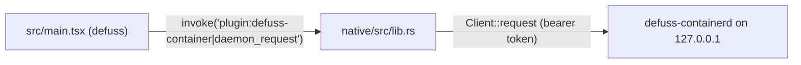

# Desktop architecture

The desktop app is a defuss UI (`src/main.tsx`) packaged by defuss-tauri 0.3.0 with one Rust extension (`native/`). It is a client of `defuss-containerd`: it never starts the daemon, owns no state and never invokes the engine.

## Why a native bridge instead of fetch from the page

The API token stays in Rust. The page calls one Tauri plugin command, `plugin:defuss-container|daemon_request`, which accepts only GET and POST below `/v1/`. That command refuses callers whose window origin is not the packaged UI, and reads `connection.json` from the same state directory the CLI uses. The daemon also rejects every browser `Origin`, so a web page in another browser cannot reach it even on loopback.

VERIFIED: defuss-tauri serves the UI from `http://127.0.0.1:<port>`, which Tauri 2.12.1 treats as a remote origin. It rejects every command from a remote origin that no capability grants: the first build showed `Command daemon_request not allowed by ACL`. The command therefore lives in a plugin (`links = "tauri-plugin-defuss-container"`, permissions generated by `native/build.rs`), and `defuss-tauri.json` grants `defuss-container:allow-daemon-request` to `http://127.0.0.1:*` in the `main` window. A plain app command has no permission a capability could name.

## UI behavior

- The UI polls `/v1/apps` and `/v1/jobs` every 3 s while connected and visible. While the daemon is unreachable it retries after 1, 2, 4 ... 30 s, so it finds a daemon started later without a click and does not poll a stopped one every 3 s. The header then shows Reconnect, which retries at once and resets the backoff. Actions queue a job and show its id; buttons for an app are disabled while it has a queued or running job.
- Logs and job output render as text, never HTML. Delete asks for the app name, and restore asks for confirmation.
- Form validation mirrors the daemon's spec rules. The daemon remains the authority. VERIFIED: browsers compile `pattern` attributes with the `v` regex flag, so an unescaped `-` at the end of a character class disables the check; `[a-z0-9\-]` keeps it working (`tests/ui.test.mjs`).

## Tests

- `bun run test:ui` runs the built UI in Chromium with a scripted bridge for offline, retry, error and layout states. It also checks that every command the UI invoked is a plugin command granted to the loopback origin in `defuss-tauri.json`.
- Neither Playwright suite runs Tauri, so neither exercises its ACL. VERIFIED: `make gui` and `make start-gui` on macOS on 2026-10-31 showed the native app connected to the `make start` daemon.
- `tests/e2e.test.mjs`, started by `make e2e`, runs the built UI in Chromium and WebKit against a live daemon and real VMs. Its bridge calls `defuss-container api`, the same `Client::request` the native extension uses. WebKit stands in for the macOS and Linux webviews, Chromium for WebView2 on Windows.
